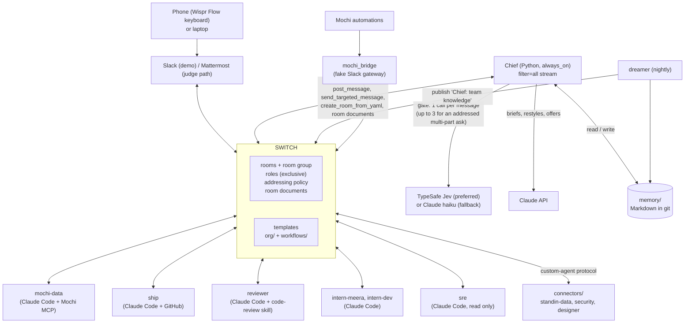

# Chief: an AI chief of staff for your team chat, built on Switch

Developers lose hours to interruptions whose real cost is rebuilding context: "where is this data?", "what did we ship?", "can you look at this bug?".
Answering takes a minute. Working out who is asking, why, and how much detail they want takes the rest.
Chief watches the team's rooms and takes those questions itself. It knows the people, holds non-urgent pings during focus time, and asks a human before it does anything consequential.

Chief is one Python process on Switch's agent protocol. It answers in Slack or Mattermost, and it only acts through Switch operations. The org chart and every repeatable process are Switch templates in git. Chief picks the template and Switch runs it.

---

## How Switch is used

Without Switch, Chief has no rooms, no roles to address, no templates to run, no addressing policy, and no specialists to hand work to. Every feature below is a Switch feature that Chief drives.

| Chief feature | Switch feature it relies on | Where |
|---|---|---|
| The whole org is code: a group, four rooms, the standing agents and their roles | v2 **room templates** with `resources` (group, agent, room) | [`org/brightcart-org.yaml`](org/brightcart-org.yaml) |
| Each repeatable process is a template: data question, shipped digest, bug fix + review, release train | v1 **room templates** with `params`, `roles`, `instructions`, `kickoff` | [`workflows/`](workflows/) |
| Hand work to "whoever is the release scribe", not to a named bot | **roles** + `send_targeted_message(target_roles=[...])`. One exception: a data-question brief goes to the data agent **by name** (`mochi-data`, or `standin-data` on the judge path), because the `data-steward` role has no holder until that agent takes it at kickoff | `chief/main.py` (`LEAD_ROLE`, `open_work_room`), `chief/switch_client.py` (`target`) |
| One on-call, one release owner at a time | **exclusive roles** (`exclusive: true`) | `org/brightcart-org.yaml` (`on-call`, `release-owner`) |
| The company's rooms live under one heading | **room groups** (`type: group`) | `org/brightcart-org.yaml` (`brightcart`) |
| Anyone in a team room can ask Chief; only owners can drive specialists | **addressing policy**: Chief `anyone_in: [product, leadership, eng, chief_ops]`, specialists and interns `owner-agents` | `org/brightcart-org.yaml` |
| An intern pauses for its developer before risky tool calls | **approval cards**: interns run with `auto_mode: false` | `org/brightcart-org.yaml`, `agents/intern-*/CLAUDE.md` |
| Chief steps in without being @-mentioned | **agent protocol**, `connection_model: always_on`, event stream with `filter=all` | `chief/switch_client.py` (`PROFILE`, `_run`) |
| Team knowledge every agent in a room can read | **room documents** (`create_room_document` / `update_room_document`), one called **"Chief: team knowledge"** | `chief/memory/dreamer.py` (`KNOWLEDGE_DOC`, `run_nightly`), `chief/switch_client.py` (`room_doc`) |
| A question opens its own private work room, with Chief's brief as the room instructions | **`create_room_from_yaml`** with `inputs` (`run_template` is wired in the client too) | `chief/main.py` (`open_work_room`), `chief/factory.py` |
| Bring existing tools (a SQLite data agent, a security scanner, a video agent) into rooms as teammates | **custom-agent protocol**: register, stream, reply in thread | `connectors/base.py` (`run_connector`) |
| Dev → QA → PM handoff: the developer, the QA person and the `qa-agent` share one private room; only the QA person's verdict counts | **v1 template** with two `user` params (`asker`, `qa`) in `users`, a `qa` **role** the `qa-agent` connector takes at kickoff, the brief **targeted by name** at `qa-agent`, and the PM told with `send_targeted_message(target_names=[ravi])` in `#product` | [`workflows/ready-for-qa.yaml`](workflows/ready-for-qa.yaml), `chief/main.py` (`_ready_for_qa`, `_qa_verdict`), `connectors/qa.py` |
| Reconnect after a dropped stream | `Last-Event-ID` reconnect, and `read_context` after a `gap` event | `chief/switch_client.py`, `chief/main.py` (`step`) |

## Architecture



## How a message flows

1. Switch streams every message in Chief's rooms (`filter=all`). Chief never answers itself, and answers another agent only when addressed.
2. A message is **addressed** to Chief when Switch says so (an `@chief` mention), or when a person's message starts with "chief" or "hey chief" (a dictated message has no mention).
3. Chief handles its commands itself (`@chief memory`, `@chief quiet`, `@chief quiet off`, `remember …`, `forget …`, `approve CODE`, `deny CODE`, `@chief tick <kind>`). Switch's Mattermost bridge swallows a leading `!word`, so address Chief with `@chief`; `!tick`-style commands also work where the chat bridge passes them through.
4. A "yes" from the same person in the thread of Chief's offer runs what was offered (see the trust ladder).
5. Otherwise Chief makes **one gate call** with the message, the sender's profile, the room, whether a mentioned teammate is in focus time, and the template and role lists. The exception: an addressed message that makes several requests is split by Claude into at most 3 parts, and each part gets its own gate call. If two or more parts lead to a reply, Chief first posts "On it, N jobs: …".
6. If the message mentions a teammate who is in focus time and the urgency is below "within the hour", Chief holds it for them (this runs even for chat between people that isn't for Chief).
7. Code turns the decision into a rung on the trust ladder (below). The gate can lower the rung but never raise it above the ceiling.
8. Chief acts. It answers from memory in the asker's style, offers in one line, asks the owner for approval, or opens a work room from a template and hands its lead the brief.
9. When the work room's lead posts its answer (a `DONE`, a table, or a long reply), Chief restyles it for the asker and posts it once in the thread the question came from (**answer-back**).

## The stories

**1. PM data question (Ravi, `#product`).** "Where's the refunds data and what did it do last month?" The gate picks `data-question`, which is a read. Reading Mochi is pre-approved in Ravi's profile, so an `offer` is lifted to `act` with no approval step. Chief opens `work-data-question-…` with the data agent in it and writes a brief into the room instructions: who asked, why, what they already know, the format, and which Mochi token to use. `mochi-data` takes the `data-steward` role and answers with a table, the query and a Mochi artifact link. Chief then posts that table back in Ravi's `#product` thread, restyled for him. Next time, if memory already holds the answer, Chief answers straight from `memory/` in the asker's style and opens no room.

**2. CEO "what shipped", by voice from the phone (Asha).** On a walk, Asha dictates into Slack through the Wispr Flow keyboard: "Hey chief, what did the team ship this week? Make it a one-minute video for the all-hands, and find out why refunds jumped." It starts with "hey chief", so it is addressed, and it makes two requests. Chief replies "On it, 2 jobs: …" and opens a room for each, `shipped-digest` and `data-question` (or offers one; reply "yes"). Because the brief mentions a video, it tells `ship` to hand over to `designer` (the `video` role, our design-agent connector) after the digest. `designer` replies with the local file path of the video. Asha's profile says one line plus a chart, and the answer comes back in her thread in that style.

**3. Developer focus time + bug → fix → review (Meera).** Meera's profile has a focus block from 10:00 to 15:00 IST. At 11:00 Dev asks Meera something in `#eng` that can wait. The gate rates the urgency below "within the hour" (2 of 3; "within the hour" itself is not held), so Chief **holds** it and replies in Dev's thread: "Meera is heads-down until 15:00; I'll pass this on. Meanwhile: …" with anything memory already knows. A releaser checks every minute. When her block ends (or on `@chief tick evening`, which releases every hold), Meera gets one batched brief per room, addressed to her by name. When a bug comes in, Chief opens `bug-fix-review`, which is built on Switch's red-blue workroom. `intern-meera` fixes on a branch and `reviewer` pushes back until each acceptance item is met. When someone in the work room says "merge" or "ship it", Chief posts an approval request owned by the asker. Meera replies `approve K7QX` from her phone, and only then does Chief tell `intern-meera` "merge approved by meera". That exact phrase is the only thing the intern merges on. It merges, replies `DONE` with the merge commit, and Chief posts that back in Meera's thread.

**4. Dev → QA → PM handoff, with tickets (Dev, Priya, Ravi).** Dev says "chief, the refunds rounding fix is ready for QA on feat/partial-refunds". The gate picks `ready-for-qa`, whose action `file_ticket` is reversible, so Chief acts. It files a GitHub issue (title and body from the brief, plus the branch, who asked and the QA owner), labelled `ready-for-qa` and `brightcart`. Tickets live in this repo's **Issues** tab under the `brightcart` label (repo set by `TICKETS_REPO`; unset, Chief says "no ticket tracker configured; tracking in this thread" and carries on). Who tests it comes from memory: a team item `qa owner: refunds → priya`, else the default QA (`priya`). Chief opens `work-ready-for-qa-…` with Dev, Priya and `qa-agent`, and replies "Filed #12 … and handed it to Priya (QA)." `qa-agent` checks out the branch in a local clone of the sample shop (`.run/brightcart-shop`, built on first use) and runs `pytest -q`. It posts `QA PASSED` or `QA FAILED` with the failing test names: no model involved, and only advice. **Only Priya decides**, and that is enforced in code the way approvals are: a known person, the room's QA, never an agent. Anyone else's "pass" is refused. On `qa pass`, Chief closes the issue ("Verified by Priya (QA)"), says so in Dev's thread, and tells Ravi (PM) in `#product` that it's ready for the next release. On `qa fail <steps>`, Chief comments the steps on the issue, swaps `ready-for-qa` for `qa-failed`, and sends it back to the developer in their thread. If the developer is in focus time and it isn't urgent, it waits in the usual focus hold.

**Org factory.** "Add a growth team: one dev called Kiran and a marketer called Zoya." Creating agents is always ask-first, and the org admin (Asha) approves it. `chief/factory.py` asks Claude for a small JSON spec only. Code renders the Switch YAML from `org/org-team.yaml.tmpl`: `#growth`, `#growth-eng` with `reviewer` and an exclusive `on-call` role, and one `owner-agents` intern per developer (`intern-kiran`). It validates names and refuses duplicates. If it cannot list the existing rooms and agents, it fails closed. Then it launches the YAML with `create_room_from_yaml`, and writes `org/growth.yaml` and the intern's `CLAUDE.md` into the repo (not committed). The model never writes YAML.

**DevSecOps release train (simulated deploy).** Ask for a release in `#eng` ("chief, cut a release of brightcart-shop"). That maps to `deploy`, which is hard ask-first, so the release owner (Meera) approves in that thread **before** the train room opens. The room opens with the requester in it. In `work-release-train-…` the agents run in a fixed order, each one addressing the next: `reviewer` reviews the range, `security` runs the scan, and `ship` (the `release-scribe`) writes release notes with a `services: N` and a `migrations: M` line, then addresses `@chief`. Chief asks the release owner a **second** time, targeted at her in the requesting thread. After that approval, Chief posts the dry-run line in the work room and in the requesting thread: "would deploy v1.4.2 to staging: 3 services, 1 migration". Nothing deploys. The security gate is code, not a model call. `connectors/security.py` posts `BLOCKED` if the scan crashes, the report is stale, there are any high or critical findings, or the secrets policy is breached, and the train stops there. (`BLOCKED` goes to `intern-<owner>` only when the message has an `owner:` line.) Otherwise it posts `PASSED` and hands over to `release-scribe`.

## Trust ladder

| Rung | What Chief does |
|---|---|
| `silent` (watch) | Reads and remembers. Never posts. |
| `offer` | One line in the thread that names the workflow it would run. If the same person replies "yes" (or "go ahead", "sure", …) in that thread within 30 minutes, Chief runs it. A yes never runs a hard-listed action. |
| `act` | Reversible only: answer, summarise, run a read query, open a work room. |
| `ask_first` | Posts an approval request to the owner of the affected thing, then waits. Only hard-listed actions get here; any other `ask_first` becomes an `offer`. |

**Code sets the ceiling. The gate can only lower it.** From [`chief/ladder.py`](chief/ladder.py):

```python
HARD_ASK_FIRST = frozenset({"merge", "deploy", "external_message", "interrupt_focus", "create_agent"})
```

- These actions are always `ask_first`, whatever the gate says. Chief has no code path that sends an external message or interrupts focus today; the two are listed so that a future one can't skip approval.
- A sender with no profile (role `unknown`) never goes above `offer`, even for pre-approved actions. Agents and unknown senders can never start an approval.
- A person's profile can lift their own `offer` to `act` for listed actions (`preapproved: [mochi_read]` for Ravi). It never removes anything from the hard list.
- At most 3 unprompted posts per room per hour. `@chief quiet` stops unprompted posts in a room, and `@chief quiet off` turns them back on.

**Who approves what** (decided in code, never by the model):

| Action | Approver |
|---|---|
| `merge` | the person who asked for the work room |
| `deploy` | the release owner (`Ctx.release_owner`, Meera in the demo), twice in a release train |
| `create_agent` | the org admin (`Ctx.org_admin`, Asha in the demo) |

An approval is a 4-character code (no 0/O/1/I). Only the named owner's `approve CODE` resolves it, and a code works once. Interns also get Switch's built-in approval cards for their own risky tool calls, because they run with `auto_mode: false`.

## Decisions: TypeSafe Jev, or Claude as the fallback

The gate asks 4 questions about each message:

| Question | Type | Use |
|---|---|---|
| `for_me` | Noul | Is this for the team's assistant, or chat between people? Unaddressed messages at ≤ 0.3 are ignored. |
| `rung` | Choice | `silent` / `offer` / `act` / `ask_first` (then capped by code) |
| `template` + `fits` | Choice + Noul | Which workflow, and does it clearly fit? Chief uses the template only if `fits` ≥ 0.7. |
| `urgency` | Score | can wait / today / within the hour / interrupt now. Below "within the hour", a ping to someone in focus time is held. |

- **TypeSafe Jev (preferred).** With `TYPESAFE_API_KEY` set, the four questions go in **one** `system_one` call (`jev-1.14.0`, 5 s timeout, no retries).
- **Claude (fallback).** Without that key, Chief asks `claude-haiku-5-5` the same four questions and parses one JSON answer (`decide_with_claude` in `chief/gate.py`). The same ceiling applies, so the fallback can still `act` on reversible requests, and it may offer instead; if it does, reply "yes".
- Either way it is one gate call per message, or one per part (at most 3) for an addressed multi-part message.
- If the gate fails (network, auth, timeout, malformed answer), Chief falls back to `offer` when addressed and `silent` otherwise. The chat loop never blocks.

Run `uv run python -m chief.gate "where is the refunds data?"` to try one Jev call and see its latency.

## Memory

Everything Chief remembers is Markdown in git that people can read and edit.

```
memory/
  MEMORY.md                      # generated index: edit the item files, not this
  people/<name>/profile.md       # role, style, focus hours, pre-approvals
  people/<name>/items/m_*.md     # one memory per file
  team/items/m_*.md              # shared team knowledge
  team/proposals/m_*.md          # dreamer suggestions; never active until a person promotes them
```

Each item has front matter (`kind`, `status`, `source`, `use_count`, `version`, `supersedes`, `edited_by_person`) and one line of text:

```markdown
---
id: m_0a11e002
tier: team
owner: team
kind: definition
status: active
source: {room: '#product', date: '2026-11-07', by: person}
edited_by_person: true
...
---
Glossary: GMV is gross merchandise value before refunds; AOV is average order value; a refund-queue ticket is tagged Refunds.
```

- **In chat:** `@chief memory` lists what Chief holds for you and the team. `remember …` adds a fact as your own edit. `forget …` archives the closest match.
- **The dreamer** (`chief/memory/dreamer.py`, `run_nightly`, on the `dream` tick at 02:00 IST or `@chief tick dream`) reads each room with `read_context` and extracts candidates. It dedups each one against similar items, then tidies each person's memory by merging, updating or retiring items. Items unused for 90 days are archived by code. If a lesson shows up for 3 or more people, the dreamer proposes it as team knowledge, and it refuses any proposal that quotes a person. Then it rewrites `MEMORY.md`, commits only `memory/` to git, publishes the team items as each room's **"Chief: team knowledge"** document (the org rooms' instructions point agents to it), and posts a "What I learned" note in `#chief-ops`. The dreamer holds Chief's loop while it runs.
- **Person edits win.** The dreamer never edits, merges or archives an item with `edited_by_person: true`. It also skips a candidate that only matches the person's own words.
- The extract, dedup, dream-personal and dream-team prompts in [`chief/memory/prompts.py`](chief/memory/prompts.py) are **ported from Mochi's memory system**, the author's own product, and reworded for Chief.

## Reproduce it

This reproduces story 1 on Switch's bundled Mattermost. The only thing you must supply is an Anthropic API key.

**Prerequisites:** Docker (running), [`just`](https://github.com/casey/just), [`uv`](https://docs.astral.sh/uv/), Node, git, openssl, curl and perl.

**Keys:** in `.env`. If it is missing, `up.sh` copies it from `.env.example`.

| Key | Needed for |
|---|---|
| `ANTHROPIC_API_KEY` (required) | Chief's briefs and restyles, the fallback gate, the dreamer, the org factory, the stand-in data agent |
| `TYPESAFE_API_KEY` (optional, preferred) | The Jev gate. Without it Chief gates with Claude: it may act, or it may offer, and then you reply "yes" |

Mochi, design-agent and the cyber-security scanner are not needed. The judge path uses the bundled stand-in data agent instead of Mochi.

```bash
git clone <this repo> chief && cd chief
cp .env.example .env            # add ANTHROPIC_API_KEY (and TYPESAFE_API_KEY if you have one)
bash scripts/up.sh              # a local Postgres already on 5432? SWITCH_DB_PORT=5434 bash scripts/up.sh
```

What `scripts/up.sh` does, in order:

1. It checks the prerequisites, loads `.env`, and stops if `ANTHROPIC_API_KEY` is empty.
2. It uses the Switch checkout in `SWITCH_DIR`. The default is `./.switch`. If that is missing, it clones `https://github.com/sandbox-quantum/switch` and checks out `SWITCH_REF`, the Switch commit Chief was tested against (`a425936d…`; set `SWITCH_REF` to override). An existing checkout is used as it is, with a note if it is at another commit.
3. In the Switch checkout, it runs `just init-env` once. That writes Switch's `.env` with fresh secrets. Then `up.sh` sets `FEATURE_FLAGS_ENABLED=agent_management,service_connections`, and adds a random `CONTROLLER_TOKEN_SECRET` if there is none. **`SWITCH_DB_PORT`** is for a machine that already runs Postgres on port 5432: set it to a free port, and `up.sh` writes `DB_PORT` and moves the Postgres host port in `deploy/local/docker-compose.yml` to match, because that file pins 5432.
4. It starts Switch, unless something already answers on `:8000/health`. It runs `just up` (Postgres and Mattermost), then `just migrate`, then `just run` in the background. Then it waits for the core and for Mattermost.
5. It runs `uv run python scripts/setup_demo.py`. Each step is skipped if it is already done, so a second run changes nothing. `--dry-run` lists what it would do. Logged in as the gateway admin from Switch's `.env`, it:
   - creates a personal registration key, `chief-hackathon-local`, and saves it to `.local-switch.env`. Agents registered with this key have an owner, and an agent needs an owner to open rooms.
   - creates the Mattermost users `asha`, `ravi`, `meera` and `dev` and the matching Switch users, then links each pair. To link a pair, it claims the identity as that person and posts the one-time `!link-account` code from their Mattermost account. Generated passwords go to `.local-test-users.json` (mode 600).
   - registers `chief` and `standin-data`, and saves their keys to `.chief.json` and `.connector-standin-data.json` (mode 600).
   - launches `org/brightcart-org.yaml`, filling Chief's slot with the existing `chief`. The specialist agents (`mochi-data`, `ship`, `reviewer`, `sre`, the interns) can't start without a Switch Console machine. If the full launch fails for that reason (`machine_unresolved` or `agents_not_created`), the script launches the same group, rooms, people, roles and docs with Chief as the only agent, and says so in one line. Story 1 doesn't need the specialists. Any other error stops the script.
   - sets Chief's addressing policy: its owner, plus anyone in a `brightcart` room. A filled slot ignores the template's `anyone_in`, so the script sets this itself.
   - builds the stand-in SQLite database, `sample/brightcart.db`.
6. It starts only `connectors.standin_data` and `chief` in the background (`chief` with `CHIEF_DATA_AGENT=standin-data`), with logs in `.run/`.
7. It prints the Mattermost URL (`http://localhost:8065`), ravi's login, and what to do:
   1. As `ravi`, in `product`, type `@chief where is the refunds data and what did it do last month?`
   2. Chief opens a data-question room or offers to. If it offers, reply `yes` in its thread.
   3. Open the new `work-data-question-…` channel. Chief's brief is there, followed by `standin-data`'s answer table.
   4. Back in `product`, Chief posts the table in ravi's thread, restyled for him.

`bash scripts/down.sh` stops chief, standin-data and Switch core. Before it kills anything, it checks that each pidfile still names that process, and it removes a stale pidfile without touching the process. If `up.sh` started Switch's containers, it then runs `just down`, which keeps the data volumes. If Switch was already running, it's left alone. The API keys in `.env` go only to chief and standin-data, never to Switch. The scripts never print a secret. The admin logins stay in Switch's `.env`, and the test users' logins are in `.local-test-users.json`.

On Apple Silicon, Mattermost runs under amd64 emulation, and it crashed once in testing. If that happens, run `bash scripts/up.sh` again.

Tests do not touch the network: `uv sync && uv run pytest`.

## Honest limitations

- **Switch has no scheduler.** Chief runs its own timer (`morning` 09:00, `evening` 18:00, `friday-digest` Fri 16:00, `dream` 02:00, IST). It logs each one as `[tick] <kind>` in `#chief-ops` and runs it in-process. A `[tick]` message from anyone is ignored. `@chief tick <kind>` from a known person fires one by hand. Hackathon issue #771 would add scheduled messages to Switch. Chief does not depend on it.
- **The task protocol is unfinished.** Chief registers with `task_protocol: {can_delegate: false, can_accept: false}`. Hand-offs are targeted messages plus step-by-step room instructions in each template, and each agent addresses the next role when its step is done.
- **Interns are owned by the admin who deploys the template.** The template schema has no owner field. Chief enforces who approves an intern's merge (the asker), so Switch's ownership is not what protects it.
- **Chief's approvals are chat replies, not native cards.** A person posts `approve CODE` / `deny CODE`, and Chief checks the replier against the owner it recorded. Native approval cards appear only for the interns' own tool calls. Approvals key on the chat username; on Mattermost that is unique.
- **In-process state is lost when Chief restarts:** rate caps, holds, pending approvals, live offers, and work-room origins (so an answer-back still due is dropped). Tick times persist in `.chief-ticks.json`, so a restart doesn't re-fire a tick.
- After a stream `gap`, Chief re-reads the room with `read_context`, but it doesn't use that context in decisions yet.
- QA verdict words are fixed (`qa pass` / `pass` / `approved`, `qa fail <notes>` / `fail: <notes>`; the whole message must be the verdict), and a QA room's state lives in Chief's memory: after a restart, Priya's verdict in an old QA room is not acted on. Urgency of a failure is a keyword check (`urgent`, `blocker`, `asap`, …), not a gate call.
- Designer files are posted as local file paths, not chat attachments.
- The security connector expects a local checkout of the cyber-security scanner. The designer connector needs a running design-agent. Real Mochi needs its own server and tokens.

## Built with

- **Switch**: rooms, roles, templates, addressing, approvals, and the agent protocol
- **TypeSafe Jev**: the preferred gate, one typed decision call per message
- **Claude**: Claude Code for the specialists and interns, the Claude API for Chief's text and the fallback gate (`claude-haiku-5-5`, `claude-sonnet-5-5`)
- **Mochi**: the governed data agent (over MCP), plus the memory prompts and the SRE first-pass design
- **design-agent**: the author's video and design agent, behind `connectors/designer.py`
- **cyber-security scanner**: the author's scanner, behind `connectors/security.py`
- **Wispr Flow**: the phone keyboard in the demo, and the whole project was built by voice
